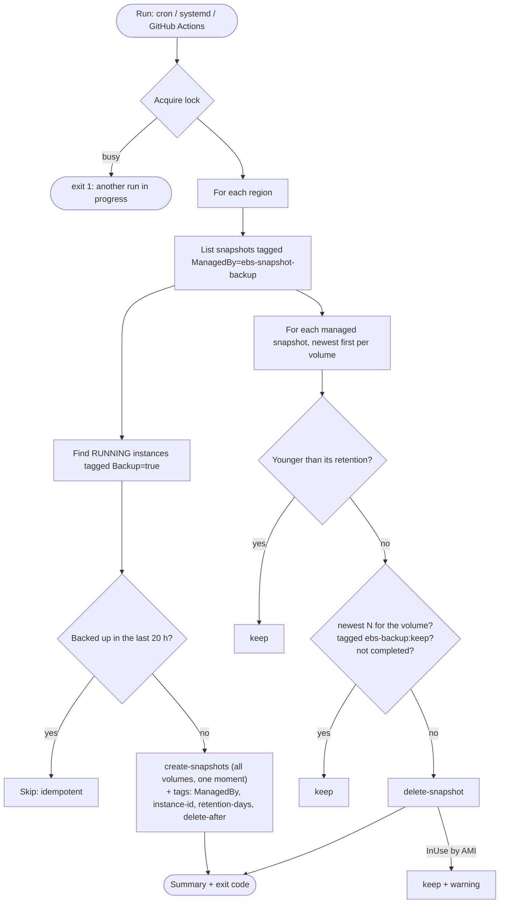

# ebs-snapshot-backup

[](../../actions/workflows/ci.yml)


A single, dependency-free **Bash + AWS CLI** script that snapshots every EBS volume attached to **running EC2 instances tagged `Backup=true`**, then applies a **retention policy**: snapshots older than **30 days** are deleted. Only snapshots this tool created are ever touched.

> **Code Clinic – Challenge #5 (Cloud Infrastructure & Provisioning).**
> *Write a Bash + AWS CLI script that snapshots all EBS volumes attached to running instances tagged Backup=true and applies a retention policy (delete snapshots older than 30 days).*

> 🎓 **New to EBS snapshots or "serious" Bash?** Read **[docs/LEARN.md](docs/LEARN.md)**. It explains every concept and technique used here (strict mode, quoting, `--query`, locking, idempotency, test doubles), with exercises.

---

## Table of contents

- [Features](#features)
- [How it works](#how-it-works)
- [Prerequisites](#prerequisites)
- [Quick start](#quick-start)
- [Usage](#usage)
- [Tags reference](#tags-reference)
- [Example output](#example-output)
- [Run it on a schedule](#run-it-on-a-schedule)
- [Security considerations](#security-considerations)
- [Idempotency notes](#idempotency-notes)
- [Restoring from a snapshot](#restoring-from-a-snapshot)
- [Testing](#testing)
- [CI pipeline](#ci-pipeline)
- [Repository layout](#repository-layout)
- [Limitations and alternatives](#limitations-and-alternatives)

---

## Features

| | |
|---|---|
| **Tag-driven selection** | Running instances with `Backup=true` (key and value configurable) |
| **Crash-consistent sets** | Uses `ec2 create-snapshots`, which snapshots **all** volumes of an instance at the same moment |
| **Per-volume opt-out** | Tag a volume `Backup=false` to skip it (e.g. scratch disks). `--exclude-boot-volume` skips root disks. |
| **Retention** | Deletes managed snapshots older than `--retention-days` (default 30). An instance tag `BackupRetentionDays=90` overrides it per instance. |
| **Safety nets** | Always keeps the newest `--keep-minimum` snapshots per volume. Never deletes `ebs-backup:keep` snapshots, pending snapshots, or snapshots used by an AMI. |
| **Only its own snapshots** | Creates and deletes only snapshots tagged `ManagedBy=ebs-snapshot-backup`, enforced again by the IAM policy |
| **Real dry run** | `--dry-run` calls EC2 with `DryRun`, so it also proves the IAM permissions |
| **Idempotent** | Skips instances already backed up within `--min-interval-hours` (20 h); a lock prevents overlapping runs |
| **Multi-region** | `--regions a,b` or `--all-regions` |
| **Observable** | Text or JSON logs, a summary line, and exit codes `0` / `1` / `2` |
| **Portable** | Linux and macOS (GNU or BSD `date`, `flock` or `mkdir` lock). The only dependency is the AWS CLI v2. |
| **Tested** | 30 [bats](https://bats-core.readthedocs.io/) tests against a fake AWS CLI, plus ShellCheck in CI |

## How it works



## Prerequisites

| Requirement | Notes |
|---|---|
| Bash **4+** | Linux has it. macOS ships Bash 3.2, so run `brew install bash`. On Windows use WSL or Git Bash. |
| [AWS CLI v2](https://docs.aws.amazon.com/cli/latest/userguide/getting-started-install.html) | `aws --version` should print `aws-cli/2…` |
| AWS credentials | Instance profile, SSO, a role or a profile, with [`iam/ebs-snapshot-backup-policy.json`](iam/ebs-snapshot-backup-policy.json) |
| For tests only | `bats`, `jq` |

## Quick start

```bash
git clone https://github.com/ngems1/ebs-snapshot-backup.git && cd ebs-snapshot-backup
chmod +x bin/ebs-snapshot-backup.sh

# 1. Tag the instances you want backed up
aws ec2 create-tags --resources i-0123456789abcdef0 --tags Key=Backup,Value=true

# 2. See what would happen (changes nothing, checks IAM permissions)
./bin/ebs-snapshot-backup.sh --regions us-east-1 --dry-run

# 3. Run it for real
./bin/ebs-snapshot-backup.sh --regions us-east-1
```

## Usage

```text
ebs-snapshot-backup.sh [options]

Selection
  -r, --regions LIST         Comma-separated regions (default: AWS CLI default region)
      --all-regions          Every region enabled for the account
  -k, --tag-key KEY          Instance tag key to select (default: Backup)
  -v, --tag-value VALUE      Instance tag value to select (default: true)
      --exclude-boot-volume  Do not snapshot root/boot volumes

Retention
  -d, --retention-days N     Delete managed snapshots older than N days (default: 30)
      --keep-minimum N       Always keep the newest N snapshots per volume (default: 1)
      --min-interval-hours N Skip instances backed up in the last N hours (default: 20)

Mode
  -n, --dry-run              Change nothing; uses EC2 DryRun to prove permissions
      --backup-only          Create snapshots, skip retention
      --prune-only           Apply retention, create nothing
      --wait                 Wait until new snapshots are completed
  -p, --profile NAME         AWS CLI profile
      --log-format FMT       text (default) or json
      --lock-file PATH       Prevent overlapping runs
```

Every default can also be set with an environment variable: `EBS_BACKUP_REGIONS`, `EBS_BACKUP_TAG_KEY`, `EBS_BACKUP_TAG_VALUE`, `EBS_BACKUP_RETENTION_DAYS`, `EBS_BACKUP_KEEP_MINIMUM`, `EBS_BACKUP_MIN_INTERVAL_HOURS`, `EBS_BACKUP_LOG_FORMAT` and `EBS_BACKUP_LOCK_FILE`.

**Exit codes:** `0` success, `1` fatal (bad options, no credentials, lock held), `2` finished but some operations failed.

## Tags reference

| Tag | On | Meaning |
|---|---|---|
| `Backup=true` | Instance | Back this instance up (configurable with `--tag-key` / `--tag-value`) |
| `Backup=false` | Volume | Skip this data volume |
| `BackupRetentionDays=N` | Instance | Keep this instance's snapshots for N days instead of the default |
| `ManagedBy=ebs-snapshot-backup` | Snapshot | **Set by the script.** Marks snapshots the script owns. |
| `ebs-backup:instance-id` | Snapshot | Set by the script; source instance (used for idempotency) |
| `ebs-backup:retention-days` | Snapshot | Set by the script; retention decided at creation time |
| `ebs-backup:delete-after` | Snapshot | Set by the script; human-readable expiry date |
| `ebs-backup:keep=true` | Snapshot | **Add it yourself** to protect a snapshot from retention (legal hold, investigation) |

## Example output

```text
2026-11-05T02:00:01Z INFO  Starting ebs-snapshot-backup 1.0.0 (tag Backup=true, retention 30d, keep-minimum 1)
2026-11-05T02:00:01Z INFO  == Region us-east-1 ==
2026-11-05T02:00:02Z INFO  i-0a1b2c3d4e5f60001 (web-prod-1): vol-0ccc3333 -> snap-0f1e2d3c4b5a60001 (keep 30d, until 2026-12-05)
2026-11-05T02:00:02Z INFO  i-0a1b2c3d4e5f60002 (db-prod-1): vol-0aaa1111 -> snap-0f1e2d3c4b5a60002 (keep 90d, until 2027-02-03)
2026-11-05T02:00:02Z INFO  i-0a1b2c3d4e5f60002 (db-prod-1): vol-0bbb2222 -> snap-0f1e2d3c4b5a60003 (keep 90d, until 2027-02-03)
2026-11-05T02:00:03Z INFO  snap-0old1 (vol-0ccc3333): 35d old > 30d retention, deleted
2026-11-05T02:00:03Z INFO  snap-0old2 (vol-0ccc3333): 36d old > 30d retention, deleted
2026-11-05T02:00:03Z WARN  snap-0ami1 (vol-0ccc3333): in use by an AMI, keeping (deregister the AMI to release it)
2026-11-05T02:00:03Z INFO  Summary: created=3 skipped=0 deleted=2 kept=1 errors=0
```

`db-prod-1` carries `BackupRetentionDays=90`, so its 45-day-old snapshot was left alone. Add `--log-format json` for one JSON object per line.

## Run it on a schedule

**systemd timer (recommended on Linux):**

```bash
sudo install -m 0755 bin/ebs-snapshot-backup.sh /usr/local/bin/
sudo useradd --system --no-create-home ebs-backup
sudo cp deploy/systemd/ebs-snapshot-backup.{service,timer} /etc/systemd/system/
sudo cp deploy/systemd/ebs-snapshot-backup.env.example /etc/default/ebs-snapshot-backup   # edit it
sudo systemctl daemon-reload
sudo systemctl enable --now ebs-snapshot-backup.timer
systemctl list-timers ebs-snapshot-backup.timer
journalctl -u ebs-snapshot-backup.service      # logs
```

The timer runs daily at 02:00 UTC with up to 15 minutes of random delay, and catches up after downtime (`Persistent=true`). The service unit is sandboxed (`ProtectSystem=strict`, `NoNewPrivileges`, …).

**cron:** see [`deploy/cron/ebs-snapshot-backup.cron`](deploy/cron/ebs-snapshot-backup.cron).

**GitHub Actions (no server):** see [`deploy/github-actions/scheduled-backup.yml`](deploy/github-actions/scheduled-backup.yml). It uses OIDC, so no AWS keys are stored; this pairs with the cross-account role from challenge #4.

## Security considerations

- **Least privilege.** [`iam/ebs-snapshot-backup-policy.json`](iam/ebs-snapshot-backup-policy.json) allows:
  - `Describe*` for discovery;
  - `CreateSnapshots` **only on instances tagged `Backup=true`**;
  - `CreateTags` **only while creating snapshots** (`ec2:CreateAction`);
  - `DeleteSnapshot` **only on snapshots tagged `ManagedBy=ebs-snapshot-backup`**.
  
  AWS itself refuses to delete anyone else's snapshots, even if the script were modified.
- **No stored keys.** Run it with an EC2 instance profile, SSO or OIDC role. Never put access keys in the env file.
- **Encryption.** Snapshots of encrypted volumes are encrypted with the same KMS key automatically. Turn on [EBS encryption by default](https://docs.aws.amazon.com/ebs/latest/userguide/encryption-by-default.html) so all new volumes and snapshots are encrypted.
- **Safe deletes.** Pending snapshots, `ebs-backup:keep` snapshots and the newest N per volume are never deleted, and snapshots used by AMIs are kept with a warning.
- **Strict Bash.** `set -euo pipefail`, quoted variables, arguments in arrays (no `eval`), JSON escaping for tag values, and ShellCheck in CI.
- **Sandboxed service.** The systemd unit runs as a dedicated non-login user with a read-only filesystem.
- **Audit.** Every action is in CloudTrail. Snapshots carry the source instance ID and a human-readable expiry date.

## Idempotency notes

- **Re-running is safe.** An instance with a managed snapshot newer than `--min-interval-hours` is skipped, so retries and duplicate cron runs create no duplicates.
- **Retention is naturally idempotent.** Already-deleted snapshots are reported as "already gone".
- **Retention is decided at creation time** (the `ebs-backup:retention-days` tag). Changing the default later doesn't retroactively shorten the life of existing backups.
- **A lock** (`flock`, or `mkdir` on macOS) prevents overlapping runs.
- **Discovery happens on every run.** Newly tagged instances are picked up, and untagged ones stop being backed up. Their existing snapshots still age out normally, with the newest kept.

## Restoring from a snapshot

```bash
# find the backups of an instance
aws ec2 describe-snapshots --owner-ids self \
  --filters Name=tag:ebs-backup:instance-id,Values=i-0123456789abcdef0 \
  --query 'Snapshots[].[StartTime,SnapshotId,VolumeId,VolumeSize]' --output table

# create a volume from one (same AZ as the instance), then attach it
aws ec2 create-volume --snapshot-id snap-0123... --availability-zone us-east-1a --volume-type gp3
aws ec2 attach-volume --volume-id vol-0abc... --instance-id i-0123... --device /dev/sdf
```

Practise a restore regularly. A backup you have never restored is only a hope.

## Testing

```bash
sudo apt-get install -y bats jq      # macOS: brew install bats-core jq
bats tests/
```

The tests use [`tests/helpers/fake-aws`](tests/helpers/fake-aws), a stand-in for the AWS CLI driven by small text files. No AWS account is needed and nothing is created. They cover:

| Area | Tests |
|---|---|
| Arguments | `--help`, unknown options, invalid numbers, conflicting modes |
| Backup | Tag filter, tags written, custom tag key/value, per-instance retention, volume opt-out + boot exclusion, idempotent skip, interval expiry, no instances, failed snapshot → exit 2, `--wait` |
| Retention | Age-based delete, ManagedBy-only listing, keep-minimum, per-snapshot retention, keep tag + pending, AMI in-use |
| Dry run | Nothing changes and EC2 DryRun is used; missing permissions are reported |
| Operations | Multi-region order, `--all-regions`, failing region, JSON logs (validated with `jq`), `--profile` on every call, lock contention |
| Unit | Timestamp parsing for both AWS CLI formats, JSON escaping |

## CI pipeline

[`.github/workflows/ci.yml`](.github/workflows/ci.yml) runs on every push to `main` and on every pull request:

| Job | What it checks |
|---|---|
| **ShellCheck** | Static analysis of the script and the fake CLI (`--severity=style`) |
| **bats tests** | All 30 tests |
| **Validate** | IAM policy JSON, systemd units (`systemd-analyze verify`), timer schedule |

## Repository layout

```
.
├── bin/ebs-snapshot-backup.sh          # the script
├── iam/ebs-snapshot-backup-policy.json # least-privilege IAM policy
├── deploy/
│   ├── systemd/                        # service + timer + env example
│   ├── cron/                           # cron alternative
│   └── github-actions/                 # scheduled workflow example
├── tests/
│   ├── ebs-snapshot-backup.bats        # 30 tests
│   └── helpers/fake-aws                # fake AWS CLI (test double)
├── docs/LEARN.md                       # beginner guide
├── .github/workflows/ci.yml
└── CHANGELOG.md  LICENSE
```

## Limitations and alternatives

- **Crash-consistent, not application-consistent.** For databases, prefer the database's own backups, or freeze I/O before the snapshot (e.g. `fsfreeze`, or AWS Systems Manager with VSS on Windows).
- **The dry run can't detect AMI usage.** EC2 DryRun only checks permissions, so a snapshot backing an AMI may show "would delete" in a dry run and be kept, with a warning, in a real run.
- **Single account per run.** For many accounts, run it with a role per account (see challenge #4), or use AWS Backup / DLM with AWS Organizations.
- **Managed alternatives.** [Amazon Data Lifecycle Manager](https://docs.aws.amazon.com/ebs/latest/userguide/snapshot-lifecycle.html) and [AWS Backup](https://docs.aws.amazon.com/aws-backup/) do tag-based schedules and retention without a script. This script is useful when you want full control, custom logic, cross-cloud consistency, or to learn how it works under the hood.

## License

[MIT](LICENSE)
# ebs-snapshot-backup

